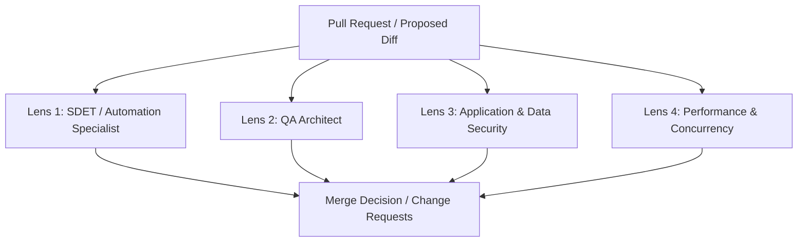

# Multi-Perspective AI Code Review Specification

Every pull request and code modification in this framework must be reviewed against four distinct technical lenses:

---

## Perspective 1: SDET & Test Automation Specialist
- **Wait Strategies**: Zero `Thread.sleep()`. Are explicit waits (`wait.until(ExpectedConditions...)`) tied to DOM states rather than arbitrary clocks?
- **Locator Resilience**: Are locators robust against DOM mutations? Avoid brittle indexed XPaths (`//div[2]/span[3]`); prefer IDs, names, and ARIA attributes.
- **Assertion Rigor**: Does the test assert domain state rather than trivial superficial checks (e.g., checking only that the page title is not null)?
- **Flakiness Risk**: Does the test rely on execution order or shared state from previous tests?

## Perspective 2: QA Architect
- **Page Object Encapsulation**: Are web elements and drivers completely hidden within Page Objects? Test classes must never import or call `By` or `WebElement`.
- **DRY & Reusability**: Are common workflows consolidated in Page Objects or API clients rather than copy-pasted across test methods?
- **API Client Independence**: Are API tests completely decoupled from Selenium?
- **TestNG Grouping**: Are `@Test` annotations properly categorized into standard groups (`Sanity`, `Smoke`, `Regression`, `ApiSmoke`, `ApiRegression`, `Unit`, `Security`, `Performance`)?

## Perspective 3: Application & Data Security (OWASP)
- **PII & Secrets Redaction**: Are passwords, SSNs, credit card numbers, or auth tokens logged in plain text anywhere in logs, extent reports, or test evidence?
- **Injection Safety**: Do dynamic queries or URLs sanitize parameter inputs?
- **Credential Hygiene**: Are test credentials generated synthetically via `CustomerDataFactory` rather than hardcoded in source files?
- **Dependency Vulnerabilities**: Are any newly introduced Maven dependencies flagged by OWASP Dependency-Check?

## Perspective 4: Performance & Concurrency
- **Thread Concurrency**: Can the new test class execute safely in parallel (`ui.threads > 1` or parallel TestNG)?
- **Driver & Resource Cleanup**: Does every execution path clean up drivers, HTTP connections, and file streams (e.g., in `@AfterMethod` or try-with-resources)?
- **SLA & Latency**: Does the test execute within reasonable time bounds (< 5s for UI, < 500ms for API)?
- **Memory Footprint**: Are large collections, DOM snapshots, or heap dumps released promptly?
