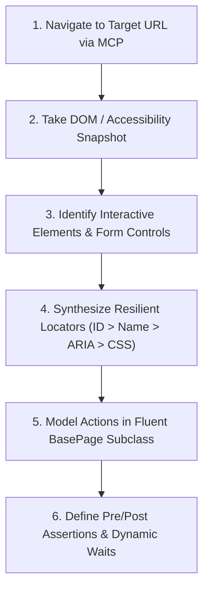

# Browser Exploration Protocol using Playwright / Chrome DevTools MCP

This guide establishes the standard protocol for exploring web applications using MCP (Playwright MCP or Chrome DevTools MCP) and synthesizing production-quality Page Objects and TestNG tests without AI hallucination.

---

## 1. Objectives & Non-Functional Requirements
- **Live DOM Discovery**: Inspect actual rendered DOM hierarchies, shadow roots, and dynamic AJAX states.
- **Resilient Locator Strategy**: Prioritize accessible roles (`aria-label`, `role="button"`, `name`, `id`) over fragile XPaths (`//div[2]/table/tbody/tr[3]`).
- **Framework Alignment**: Extracted locators and interaction patterns must map directly into `pageobjects.BasePage` subclasses returning `this` or the next page object.

---

## 2. Step-by-Step Exploration Protocol



### Step 1: Navigating and Snapshotting
1. Use `navigate_page` to open the target route (e.g., `http://127.0.0.1:8081/parabank/register.htm`).
2. Use `take_snapshot` to extract the full DOM tree and accessibility hierarchy.
3. Validate presence of dynamic asynchronous libraries (e.g., jQuery AJAX in ParaBank: `window.jQuery.active === 0`).

### Step 2: Locator Extraction Hierarchy
When generating `By` locators in Java:
1. **ID**: `By.id("customer.firstName")` (deterministic, unique).
2. **Name**: `By.name("customer.ssn")` (standard form elements).
3. **CSS Selector with Attribute**: `By.cssSelector("input[value='Register']")`.
4. **Normalized Link Text**: `By.linkText("Log Out")`.
5. **FORBIDDEN**: Absolute XPaths (e.g., `/html/body/div/div[2]/...`) or locators relying on transient indices.

### Step 3: Synthesis into Page Object Method
Synthesize interactions using protected `BasePage` methods:
```java
public RegistrationPage enterFirstName(String firstName) {
    type(By.id("customer.firstName"), firstName);
    return this;
}
```

---

## 3. Validation Rules
- **No Raw Thread.sleep**: Any wait must be handled via `wait.until(ExpectedConditions...)` in `BasePage`.
- **Sensitive Fields**: Passwords, SSNs, and PINs must be flagged so `BasePage.type()` redacts them in debug logs.
- **Zero Hallucinated Elements**: An element may only be added to a Page Object if its presence is verified via the MCP snapshot.
