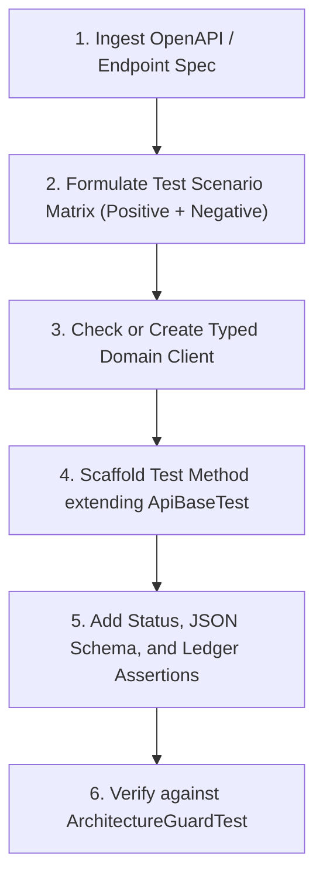

# API Test Automation & Review Skill

This skill provides expert guidance and automated workflows for designing, generating, and reviewing REST Assured API automation tests for Java/TestNG frameworks adhering to enterprise standards.

---

## 1. Core Architectural Standards

When generating or reviewing API automation tests, enforce these mandatory design principles:

### A. Strict Decoupling from UI Automation
- API test classes must inherit from `base.ApiBaseTest`.
- Never import or touch Selenium `WebDriver`, `By`, or Page Objects in API tests.
- UI tests and API tests must run in isolated suites (`master.xml` vs `api.xml`).

### B. Typed Client Abstraction Layer
- Never call raw `RestAssured.given()` in test classes.
- All HTTP operations must route through domain client classes in `utilities.api.clients` (`AccountClient`, `CustomerClient`, `LoanClient`, `TransactionClient`).
- Request parameters and headers are configured via `utilities.api.ApiRequestFactory`.

### C. Fixture Isolation & Ephemeral State
- Never hardcode customer credentials, user IDs, or account numbers.
- Utilize the pre-provisioned `this.fixture` supplied by `ApiBaseTest` (`fixture.customer()`, `fixture.fundingAccount()`).
- Each test gets an isolated customer record, preventing state collision during parallel test runs.

### D. Pre/Post State Ledger Invariants
- For every state-mutating request (e.g., transfers, deposits, withdrawals, bill payments):
  1. Capture pre-request balances and transaction history.
  2. Perform the API call and assert HTTP status.
  3. Query the account and verify that:
     $$\text{Balance}_{\text{after}} = \text{Balance}_{\text{before}} \pm \Delta$$
  4. Query the transaction ledger and assert that a matching ledger entry (Debit/Credit) was recorded.
- For negative requests (malformed input, unauthorized access):
  - Assert that balances and ledgers remain completely unmodified.

---

## 2. API Test Generation Workflow



### Scenario Generation Checklist
1. **Happy Path**: Valid payload, authenticated fixture, HTTP 200/201, schema compliance.
2. **Schema & Boundary Validation**: Missing required fields, overlong strings, negative numbers.
3. **Authentication & Authorization (BOLA/IDOR)**: Missing credentials, invalid token, accessing resources belonging to another user.
4. **Idempotency & Race Conditions**: Resending the exact same POST transaction request.
5. **Transport Security**: Secrets/passwords must never appear in query parameters or URL paths.

---

## 3. Standard Code Generation Pattern

```java
package testclasses.api;

import java.math.BigDecimal;
import java.util.List;
import org.testng.Assert;
import org.testng.annotations.Test;

import base.ApiBaseTest;
import io.restassured.response.Response;
import utilities.api.models.Account;
import utilities.api.models.Transaction;

public class SamplePaymentApiTest extends ApiBaseTest {

    @Test(groups = {"ApiSmoke", "ApiRegression"}, description = "Verify fund transfer debit and ledger credit")
    public void testFundTransferStateInvariants() {
        // 1. Arrange: isolated accounts from fixture
        Account fromAccount = fixture.fundingAccount();
        Account toAccount = fixture.createAccount(1); // Savings account
        BigDecimal transferAmount = new BigDecimal("50.00");

        BigDecimal fromBefore = fromAccount.balance();
        BigDecimal toBefore = toAccount.balance();

        // 2. Act: perform transfer via client
        Response response = accounts.transfer(fromAccount.id(), toAccount.id(), transferAmount);
        Assert.assertEquals(response.getStatusCode(), 200, "Transfer endpoint should return 200 OK");

        // 3. Assert: verify ledger and balance invariants
        Account fromAfter = utilities.api.assertions.ApiAssertions.account(accounts.get(fromAccount.id()));
        Account toAfter = utilities.api.assertions.ApiAssertions.account(accounts.get(toAccount.id()));

        Assert.assertEquals(fromAfter.balance(), fromBefore.subtract(transferAmount), "From account must be debited");
        Assert.assertEquals(toAfter.balance(), toBefore.add(transferAmount), "To account must be credited");
    }
}
```

---

## 4. Multi-Perspective API Review Checklist

When reviewing API tests, score across 4 criteria:
- [ ] **Contract Integrity**: Does the test validate response shape and HTTP status against OpenAPI specs?
- [ ] **State Invariant**: Does the test confirm persistence, or does it only check status code?
- [ ] **Data Redaction**: Does `ApiEvidenceFilter` mask all passwords, tokens, and SSNs in request logs?
- [ ] **Independence**: Is the test completely runnable without any Selenium or UI browser components?
