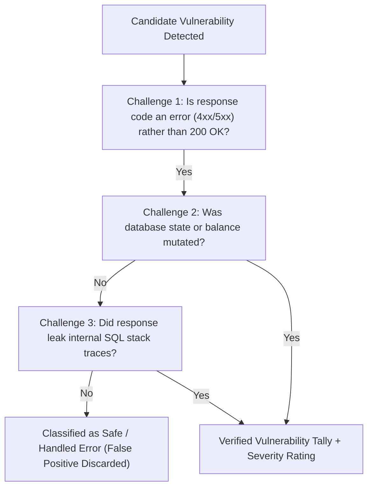

# Deep Security Scanner Skill

This skill performs rigorous vulnerability audits while actively preventing false positives through automated verification challenges.

---

## 1. Scanning Dimensions

### A. Third-Party Dependency Analysis (SCA)
- Runs OWASP Dependency-Check via `.\mvnw.cmd -Psecurity-audit dependency-check:check`.
- Scans `pom.xml` dependencies against National Vulnerability Database (NVD) CVE entries.
- Flags dependencies with CVSS score &ge; 7.0 (High/Critical).

### B. OWASP API Top 10 Dynamic Verification
- Runs `testclasses.security` suite via `.\mvnw.cmd -Psecurity verify`.
- Tests for:
  - **BOLA / IDOR**: Unauthorized cross-account data access (`BrokenAccessControlTest`).
  - **SQL Injection**: Input fuzzing with SQL syntax escapes (`SqlInjectionNegativeTest`).
  - **Security Headers**: MIME type sniffing and caching controls (`SecurityHeadersTest`).

---

## 2. False-Positive Challenge Protocol

Every reported vulnerability must provide:
- **Reproducible Request**: Method, URI, and Headers.
- **Observed Response**: HTTP status and body proof.
- **Verification Tally**: Proof that state mutation or raw information leakage occurred.
