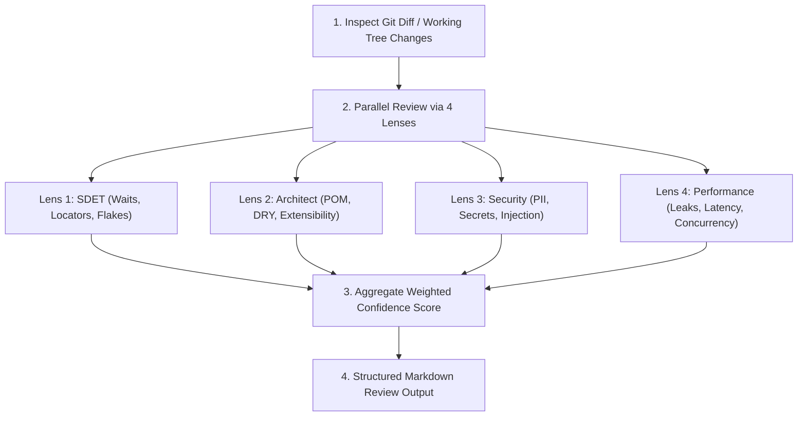

# Multi-Perspective Code Review Skill

This skill guides automated code reviews across four independent technical perspectives.

---

## 1. Execution Flow

---

## 2. Review Checklist Matrix

| Dimension | Mandatory Check | Severity if Violated |
| :--- | :--- | :--- |
| **SDET** | No `Thread.sleep()` in test or page code | **Critical (Blocker)** |
| **SDET** | Explicit `WebDriverWait` with expected condition | **High** |
| **Architect** | Page Object methods return `this` or next logical PageObject | **Medium** |
| **Architect** | Zero Selenium imports in `testclasses.api` | **Critical (Blocker)** |
| **Security** | Sensitive fields redacted in logs and `toString()` | **High** |
| **Security** | Zero hardcoded plaintext passwords in source | **High** |
| **Performance**| Drivers closed in `@AfterMethod(alwaysRun = true)` | **High** |
| **Performance**| API tests execute within SLA budget (< 1500ms) | **Medium** |

---

## 3. Output Format

Always format reviews with:
1. **Summary of Changes**: What changed and why.
2. **Perspective Breakdown**: Findings grouped by SDET, Architect, Security, Performance with file links and line numbers.
3. **Score Card**: Individual scores out of 25 points each (Total 100).
4. **Merge Decision**: `APPROVED` or `CHANGES REQUESTED`.
