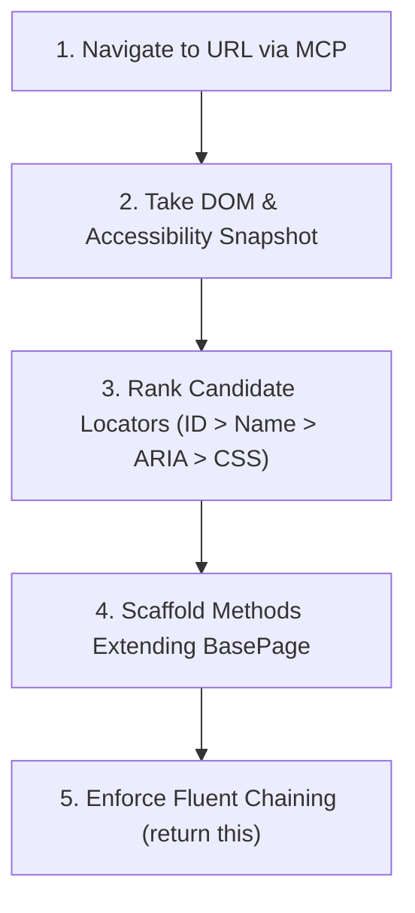

# Playwright MCP Explorer Skill

This skill guides the automated exploration of live web applications via MCP tools (`chrome-devtools-mcp` or `playwright`) and converts live DOM interactions into robust Java Page Objects.

---

## 1. Live Exploration Protocol



---

## 2. Element Extraction Best Practices

When extracting elements from live pages:
1. **Forms**: Extract `name` or `id` attributes directly matching backend model properties (e.g. `By.id("customer.firstName")`).
2. **Buttons & Submits**: Prefer explicit CSS selectors with value/type or ARIA labels: `By.cssSelector("input[value='Log In']")`.
3. **Data Grids & Tables**: Extract wrapper table IDs (e.g. `By.id("accountTable")`) and model rows as component sub-objects (e.g. `TransactionTable`).
4. **Avoid Flaky Selectors**: Never generate absolute XPaths or selectors containing generated session hashes.

---

## 3. Java Synthesis Pattern

```java
package pageobjects;

import org.openqa.selenium.By;
import org.openqa.selenium.WebDriver;

public class SampleExploredPage extends BasePage {

    private final By accountTypeSelect = By.id("type");
    private final By submitButton = By.cssSelector("input[value='Open New Account']");

    public SampleExploredPage(WebDriver driver) {
        super(driver);
    }

    public SampleExploredPage selectAccountType(String type) {
        type(accountTypeSelect, type);
        return this;
    }

    public SampleExploredPage clickSubmit() {
        click(submitButton);
        return this;
    }
}
```
