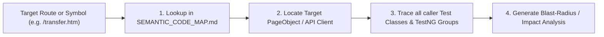

# Serena Semantic Code Navigator Skill

This skill provides semantic code understanding, symbol search, and safe refactoring workflows using `SEMANTIC_CODE_MAP.md` and Java AST structure.

---

## 1. Symbol & Route Resolution Protocol

---

## 2. Refactoring Safety Workflow

When refactoring a Page Object method, locator, or API client method:
1. **Find Usages**: Scan all test classes in `src/test/java/testclasses/` for call sites.
2. **Atomic Update**: Rename the definition and all invocation points.
3. **Verify Compilation**: Execute `./mvnw.cmd -DskipTests test-compile` to detect any broken references.
4. **Run Unit & Guardrail Gate**: Execute `./mvnw.cmd -B -ntp -Punit test` to confirm `ArchitectureGuardTest` passes without violations.
